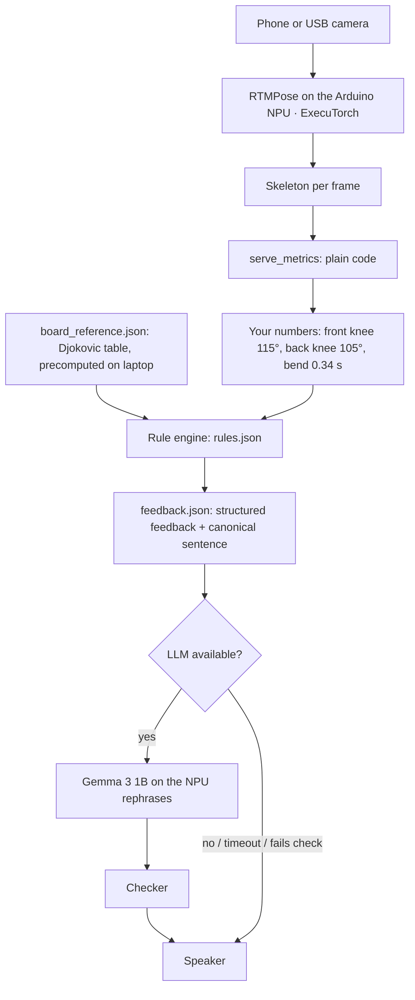

# Djoker: a tennis serve coach that runs on the court

<p align="center"></p>

Most club players never get a coach to watch their serve. Djoker does it with one camera and an Arduino VENTUNO Q. You serve, it tracks your body, compares your motion with Novak Djokovic's, and gives you live coaching via audio device.

The AI models (pose and language) run on the board through **ExecuTorch on the Qualcomm Hexagon NPU**, and a laptop hosts the app. Nothing goes to the cloud, so it works without court Wi-Fi.

## How it works



The AI does: pose estimation, analysis, audio coaching, everything is on the edge device. All the recordings are on device, you can get coaching everywhere, any time without the need or internet and a coach in your area. The rule engine picks the fault and the direction of the fix. We use Qwen and Piper for real time feedback and audio, gemma for post shot analysis, RTMPose Qualcomm AI hub models to standardize the interface to AI models.

The diagram is the full design. Two front ends implement it today. The **web app** runs pose and Gemma on the NPU and shows the cue on screen. The **command-line coach** runs the `rules.json` → checker → speaker path with Piper voice, using pose on the laptop CPU.

**Linux vs MCU.** All inference runs on the board's Linux side (QCS8275 and its NPU). The STM32H5 microcontroller handles physical I/O: a button to mark a serve and an LED for the result, over the Arduino Bridge. It never runs a model.

## See it work

One amateur serve, end to end. The source is [USOpen John on YouTube](https://www.youtube.com/watch?v=0genZFgM61E&t=4s).

| | |
|---|---|
|  | **1. Track the body.** RTMPose finds 17 joints in every frame. Blue is left and orange is right. We check that they never swap before trusting any angle. |
|  | **2. Compare with Djokovic.** Your knee angles (orange) against Djokovic's typical range over 82 serves (blue), viewed from the same camera angle. Here the front knee is straighter (115° vs 103°) and the back knee bends more (105° vs 120°). |
|  | **3. The reference.** 88 Djokovic serves (and 219 Sinner serves) from a published 3D pose dataset, reduced to a 50 KB lookup table the board reads. |

**The command-line coach says:** *"Score 81. Good leg drive. Sink into your front knee, not your back knee."*

The web app also overlays the pro's skeleton on your video at quarter speed, aligned phase by phase. Full clip: [`serve1_overlay.mp4`](docs/media/serve1_overlay.mp4).

## Proof it runs on the NPU

We measured it with ExecuTorch's profiler instead of assuming it from a successful model load. Details: [docs/executorch-npu.md](docs/executorch-npu.md).

| RTMPose on the VENTUNO Q | Time per frame | Memory | Accuracy vs full precision |
|---|---|---|---|
| **NPU (ExecuTorch QNN, fp16)** | **6.45 ms** | 50 MB | 100% |
| CPU, fastest (ExecuTorch XNNPACK, int8) | 27.9 ms | 41 MB | 99.5% |
| CPU, full precision (XNNPACK, fp32) | 85.9 ms | 140 MB | 100% |

- **Every operator runs on the NPU.** The ETDump profile shows that 300 of 302 events are delegated to QNN, and the other two are wrappers ([raw CSV](demo/ventuno-pose/proof/qnn_fp16_etdump_ops.csv)).
- **Gemma 3 1B** (ExecuTorch QNN) generates ~30 tokens/s on the NPU, with the first token after 60 ms.
- Same skeleton as the CPU: 0.24 px average difference ([overlay](demo/ventuno-pose/proof/overlay_qnn_vs_ort.png)).

## Quick start

You need Python 3.10+, Node 20.9+, `ffmpeg`, `adb`, and a VENTUNO Q with the ExecuTorch QNN runner and the model files ([setup details](docs/executorch-npu.md#2-how-the-pte-files-were-produced)). Without a board, everything falls back to the laptop CPU.

```sh
git clone https://github.com/dollar-zhu/ProjectDjoker.git && cd ProjectDjoker
sh setup.sh                      # Python environment
cd web && npm ci
DJOKER_PYTHON="$PWD/../.venv/bin/python" npm run dev -- --port 3017
```

Open http://127.0.0.1:3017, then either:
- **Upload** a video of one serve filmed from behind, draw a box around the player, and press **Process serve**, or
- **Start camera**, raise a hand to arm recording, serve on **GO**, and the review opens automatically.

Pick Djokovic or Sinner to see your similarity score and the overlay, then press **Analyse with Gemma** for your cue.

There is also a command-line coach that speaks its feedback: `.venv/bin/python scripts/run_live.py --source serve.mov --audio piper --allow-unvalidated-reference`.

## Limits

- One 2D camera: comparisons are only valid from behind or near-behind the server.
- No ball or racket tracking. "Contact" is estimated from the highest wrist position.
- Coaching rules are draft values and have not been validated with coaches. Similarity to Djokovic is not the same as a good serve.
- The NPU model is fp16; int8 runs only on the CPU so far.

## More

[Pipeline and component reference](docs/pipeline.md) · [NPU evidence](docs/executorch-npu.md) · [Web app](web/README.md) · [Board setup](docs/board-port.md) · Tests: `cd web && npm test`, `.venv/bin/python -m unittest discover -s tests`

## Team Djoker

| Name | Email |
|---|---|
| Dollar Zhu | dollarzhu.bizz@gmail.com |
| Jed Ng | jednghk@gmail.com |
| Lohith Artham | arthamlohith8@gmail.com |

## License and credits

The code is released under the [MIT License](LICENSE). Files under `demo/ventuno-pose/et/boardsrc/` are modified ExecuTorch sources and keep their BSD headers. The optional Piper speech package is GPL-3.0.

- **Pro reference data:** [Tennis Serve Analysis Dataset](https://github.com/jasnwag/tennis_serve_dataset) (Jason Wang et al., University of Virginia, 2026), CC BY 4.0, see [DATA_LICENSE](DATA_LICENSE).
- **Serve footage** in `docs/media/`: from [this video by USOpen John](https://www.youtube.com/watch?v=0genZFgM61E&t=4s), used for demonstration only. All rights remain with the creator, and it is not covered by the MIT License.
