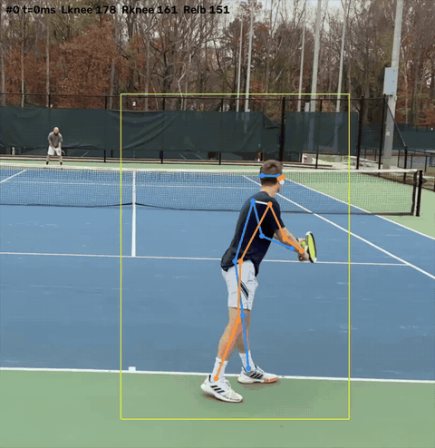
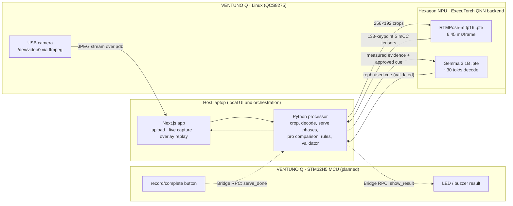
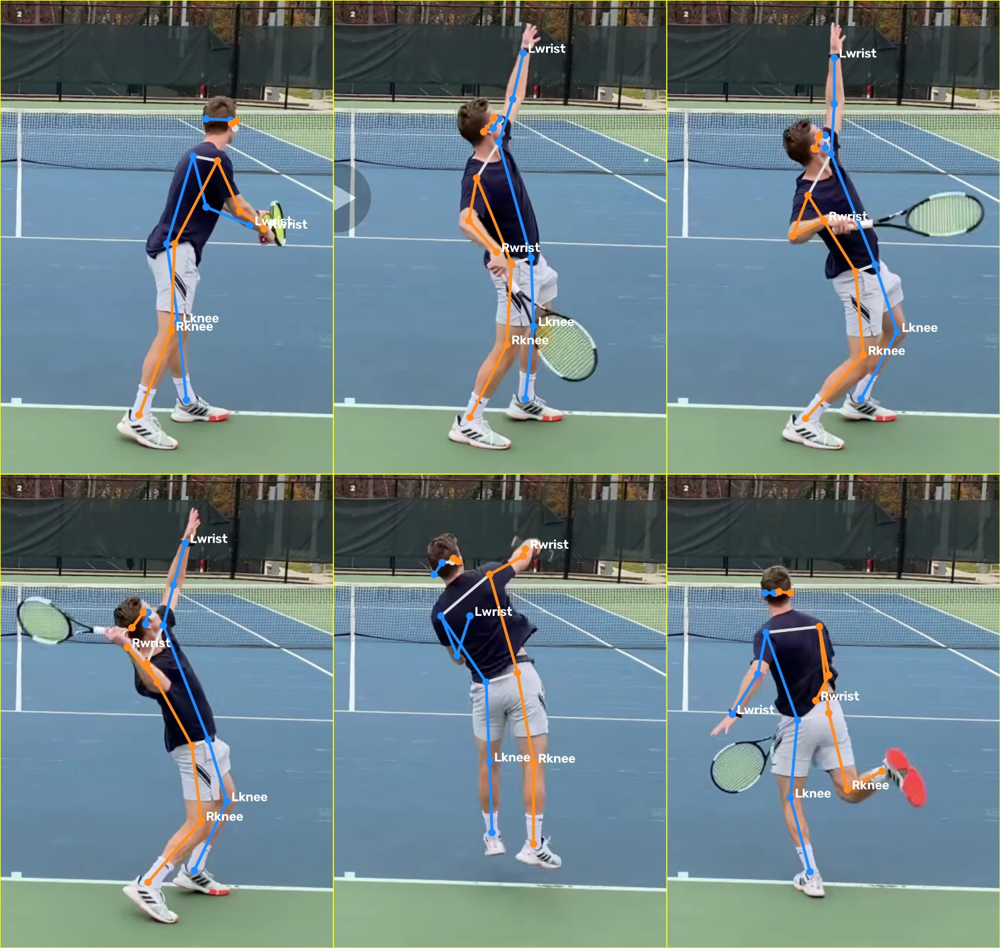
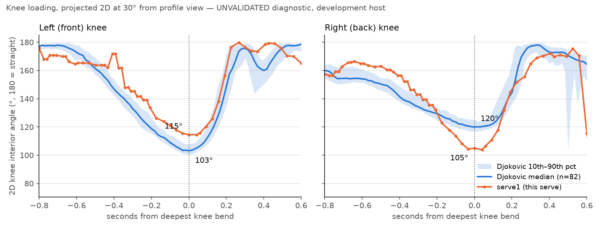
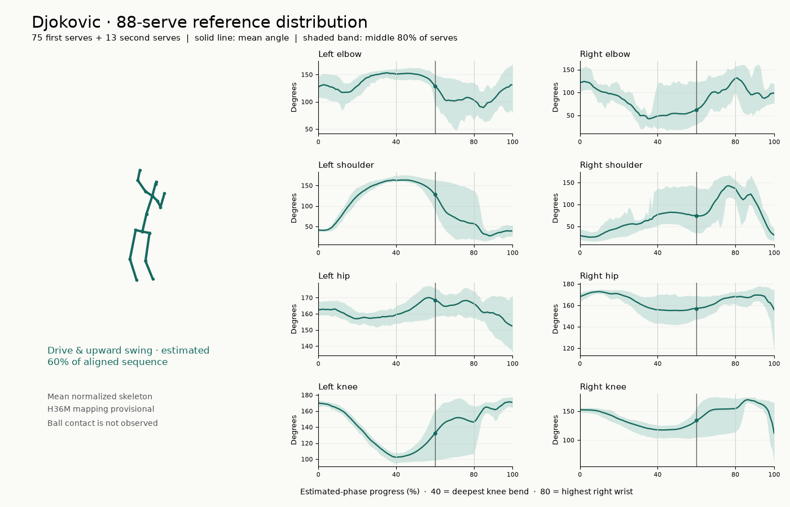
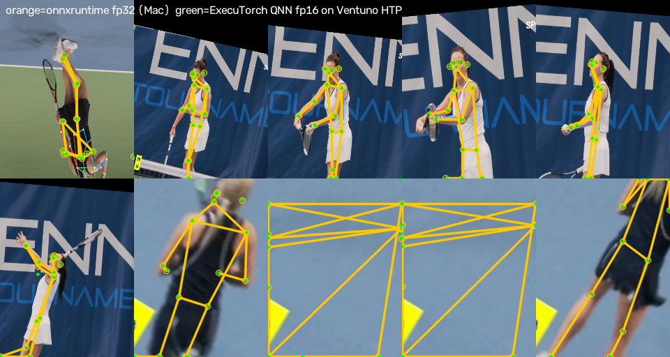

# Project Djoker: an on-device tennis serve coach

Film a serve. A few seconds later, Djoker shows your skeleton next to Djokovic's or Sinner's at the same phase of the motion and gives **one** practice focus, grounded in your own measured angles. Pose estimation and language generation run through **ExecuTorch on the Qualcomm Hexagon NPU** of an Arduino VENTUNO Q. No video leaves the device, and the app needs no internet connection on court.

> **Demo video:** submitted through the hackathon portal · **Track:** IoT (Arduino VENTUNO Q, Qualcomm Dragonwing QCS8275)

<p align="center"></p>

## Why this matters

Most recreational players never get a coach to watch their serve, and generic video apps either upload footage to the cloud or give vague feedback. Djoker gives players a fixed camera and a small board that:

- **Watches a real physical action**: a full-body serve, filmed from behind or the side.
- **Closes the loop between serves**: capture → NPU pose → serve phases → comparison with a pro reference → one cue → overlay replay.
- **Keeps inference on the device** for three reasons:
  1. **Privacy**: the footage shows identifiable people, often minors at clubs and schools. Raw video stays on the board and laptop by default; nothing is uploaded.
  2. **Connectivity**: tennis courts often have poor or no Wi-Fi. Nothing calls a cloud API.
  3. **Latency and cost**: RTMPose takes **6.45 ms/frame on the NPU** versus 27.9 ms on the board's fastest CPU configuration, so a 4-second serve clip is analyzed in well under a second of model time with no per-use fee.

Feedback is deliberately conservative. Deterministic rules choose the fault and the direction of the fix. The on-device LLM only rephrases an approved cue, and a validator rejects anything it adds. When the camera angle or tracking quality does not support a comparison, Djoker says so instead of guessing.

## How it works



**Where Linux inference ends and MCU control begins.** All ML inference (pose and language) runs on Linux, on the NPU, through ExecuTorch. The STM32H5 is reserved for hard real-time physical I/O: the button that marks a finished serve, and an LED or buzzer that shows the result. These go through the Arduino Router Bridge (MsgPack-RPC). The MCU never runs a model, and Linux never toggles GPIO directly. **The MCU link is not implemented yet** (dashed lines); today recording is started by a raised-hand ready gesture (or **Start recording**) and ended by automatic follow-through detection (or **Stop & analyse**), and the result appears on screen. See [docs/executorch-npu.md §4](docs/executorch-npu.md#4-linux--mcu-boundary).

### The input-to-action loop

1. **Capture:** upload a phone clip, or use the board's USB camera. In the default hands-free mode, the player raises a hand to arm recording, gets a 3-2-1 countdown, serves on **GO**, and recording stops on its own after the follow-through.
2. **Pose on the NPU:** each frame is cropped to the player and run through `rtmpose_qnn_fp16_QCS8275.pte` by `qnn_executor_runner` on the Hexagon HTP.
3. **Serve phases:** loading (deepest knee bend) and reach (highest hitting wrist) are detected from the 2D skeleton.
4. **Compare:** a Djokovic (88 serves) or Sinner (219 serves) pose sequence, rotated into the same rear view, is time-aligned to your motion phase by phase (anchored at loading and reach) and overlaid on your video at quarter speed. An experimental 0–100 body-similarity score summarizes how closely twelve torso and limb joints follow the selected pro serve.
5. **One cue:** a rule picks one practice focus from the knee angles at loading. Gemma 3 1B on the NPU rephrases it, a validator checks the reply, and the template is used if the reply fails.

## See it work

Artifacts from one real amateur serve (`serve1`) processed end to end, then the pro reference it is compared against. The serve is a short excerpt from [*Mens 4.5 ntrp tennis match court level highlights, USOpen John vs Tennis Viking*](https://www.youtube.com/watch?v=0genZFgM61E&t=4s) by [USOpen John](https://www.youtube.com/@usopenjohn3725) on YouTube. It is used here only to demonstrate the analysis; all rights remain with the creator.

| | |
|---|---|
|  | **Pose tracking on a real serve.** RTMPose 2D skeleton per frame (blue = left side, orange = right side) inside the player crop (yellow), with the measured left/right knee and hitting-elbow angles printed live. Full-quality clip: [`serve1_overlay.mp4`](docs/media/serve1_overlay.mp4). |
|  | **Left/right sanity check.** Six keyframes from setup through trophy, contact and landing, with wrists and knees labelled. We check that left and right never swap before trusting any joint angle. |
|  | **Comparison with Djokovic.** Knee angles around the deepest bend (orange) against Djokovic's median and 10th–90th percentile band over 82 serves (blue). The reference is projected into the same 30° camera view. Here the front knee bends less than Djokovic's (115° vs 103°) and the back knee more (105° vs 120°). The coach turns this into one spoken cue. Actual output for this serve (demo mode, `--allow-unvalidated-reference`): *"Score 81. Good leg drive. Sink into your front knee, not your back knee."* |
|  | **The pro reference.** 88 Djokovic serves from the UVA Tennis Serve Analysis Dataset: mean pose, eight joint-angle trajectories with percentile bands, and estimated phases ([animated GIF](reference/djokovic-88-serves.gif), [interactive page](visualization/index.html)). A 219-serve Sinner reference is in `sinner/`. |
|  | **The NPU gives the same skeleton.** RTMPose keypoints from ExecuTorch QNN on the Hexagon NPU (green) against onnxruntime fp32 (orange) on 20 serve crops: 0.24 px mean error, PCK@0.05 = 1.000. |

The `serve1` images were produced by the CPU development path (`pose2d` + `compare2d`, onnxruntime), which runs the same 2D event detection and comparison as the board. The knee comparison is labelled *unvalidated*: the rules are draft values, and the camera-angle estimate and joint mapping have no validation record yet (see [docs/pipeline.md](docs/pipeline.md)).

## ExecuTorch and NPU evidence

The claims below are backed by profiling, not by a successful model load. Full write-up: **[docs/executorch-npu.md](docs/executorch-npu.md)**.

| RTMPose-m on the VENTUNO Q | Per frame | Peak RSS | Accuracy vs fp32 (PCK@0.05) |
|---|---|---|---|
| **ExecuTorch QNN, HTP fp16 (NPU)** | **6.45 ms** (4.49 ms hot loop) | **50 MB** | **1.000** |
| ExecuTorch XNNPACK int8, CPU (8 threads) | 27.9 ms | 41 MB | 0.995 |
| ExecuTorch XNNPACK fp32, CPU (4 threads) | 85.9 ms | 140 MB | 1.000 |

- **ETDump profile** ([`qnn_fp16_etdump_ops.csv`](demo/ventuno-pose/proof/qnn_fp16_etdump_ops.csv)): **300 of 302** execute events are QNN-delegated. The other two are the `Method::execute`/`DELEGATE_CALL` wrappers, so **no operator falls back to the CPU**. The HTP timers show 4.17 ms of accelerator execution and 6.81 M cycles per inference on 4 HVX threads.
- **Real footage:** 230/230 frames from three tennis clips ran on the NPU at a 4.46 ms/crop mean (p95 4.73 ms).
- **Gemma 3 1B (ExecuTorch QNN):** 508–627 tok/s prefill, ~30 tok/s decode, 59–65 ms time to first token.
- **How it was built:** ONNX → `onnx2torch` → static-shape rewrite → `torch.export` → `to_edge_transform_and_lower_to_qnn` on the board with a QCS8275 (HTP v75) chipset entry we added to ExecuTorch 1.5.0. Scripts are in [`demo/ventuno-pose/et/`](demo/ventuno-pose/et/).

## Team

**Team Djoker**

| Name | Email |
|---|---|
| Dollar Zhu | dollarzhu.bizz@gmail.com |
| Jed Ng | _TODO_ |
| Lohith Artham | _TODO_ |

## Repository layout

| Path | What |
|---|---|
| `web/` | Next.js app and Python processor: upload, live capture, NPU pose, overlay replay, on-board commentary ([web/README.md](web/README.md)) |
| `demo/ventuno-pose/et/`, `demo/ventuno-pose/proof/` | ExecuTorch export scripts and committed NPU profiling evidence |
| `live/`, `coaching/`, `compare2d/`, `pose2d/`, `dms/` | Pip-installable CLI coach (`djoker-run`): camera → pose → serve packet → rules → Piper speech ([docs/pipeline.md](docs/pipeline.md)) |
| `reference/`, `sinner/` | Djokovic (88) and Sinner (219) pro-serve references from the UVA Tennis Serve Analysis Dataset |
| `benchmark/manual/` | Manually reviewed development clips and the 230-frame NPU run |
| `docs/` | [ExecuTorch/NPU evidence](docs/executorch-npu.md), [pipeline reference](docs/pipeline.md), [board port](docs/board-port.md), [DMS v0.1 data contract](docs/dms-v0.1.md) |

## Dependencies

**Host (macOS or Linux):** Python 3.10+ (tested on 3.14), Node.js 20.9+ with npm, `ffmpeg`/`ffprobe`, and `adb` (Android platform-tools) to reach the board. Python packages are pinned in `requirements.txt` (analysis: numpy, pandas, matplotlib, …) and `requirements-pose.txt` (OpenCV, onnxruntime, piper-tts); `setup.sh` installs both. Web dependencies are pinned in `web/package-lock.json` (Next.js 16, React 19).

**Board (Arduino VENTUNO Q):** Ubuntu 24.04 aarch64 with the system QAIRT 2.49 libraries (`libqnn1`, `qairt-libs`, `qairt-dsp-binaries`), `ffmpeg`, an ExecuTorch build with `EXECUTORCH_BUILD_QNN=ON` (provides `qnn_executor_runner` and `qnn_llama_runner`), and the model files:

| File on the board | How to get it |
|---|---|
| `~/models/et/rtmpose_qnn_fp16_QCS8275.pte` (38.8 MB) | Export with [`demo/ventuno-pose/et/`](demo/ventuno-pose/et/README.md) |
| `~/models/gemma3-1b_qcs8275_ctxt-5000/{*.pte, tokenizer.json}` | Qualcomm IoT track model bundle |

Model binaries and SDKs are not committed (size and licensing). Paths are set at the top of `web/processor/worker.py` and `web/processor/commentary.py`.

**No board?** The app falls back to onnxruntime on the host CPU. Set `DJOKER_ONNX` to the RTMPose-Body2d ONNX export (133 keypoints). The demo is then fully functional, but no inference runs on the NPU.

## Setup

```sh
git clone https://github.com/dollar-zhu/ProjectDjoker.git && cd ProjectDjoker
sh setup.sh                                   # .venv with pinned analysis + pose/speech dependencies
cd web && npm ci                               # web dependencies
```

Connect the VENTUNO Q over USB and confirm `adb devices` lists it. The default serial is `242692658`; override it with `DJOKER_SERIAL`. For on-device speech in the CLI coach, download the Piper voice once:

```sh
.venv/bin/python -c "from live.audio import fetch_voice; fetch_voice()"
```

## Usage

### 1. Serve review app (main demo)

```sh
cd web
DJOKER_PYTHON="$PWD/../.venv/bin/python" npm run dev -- --hostname 127.0.0.1 --port 3017
```

Open http://127.0.0.1:3017. The status badge reads **Ventuno connected** (pose runs on the NPU) or **Mac CPU available** (fallback). Each review reports the backend and the mean model time per frame.

- **Upload a clip:** drop a phone video of one serve (MP4/MOV, 0.5–20 s), draw a box around your player, set the camera view (**Behind the server** for pro comparison) and hitting hand, then **Process serve**. The review shows the timestamped skeleton, loading/reach moments and quality checks.
- **Compare with a pro:** pick Novak Djokovic or Jannik Sinner. The **Experimental body similarity** panel shows a 0–100 score, joint coverage, and which body regions were compared. **Overlay Djokovic · 0.25×** plays the reference skeleton (dashed blue) over your video, following your pace within each phase.
- **Get one cue:** **Analyse with Gemma** sends the measured evidence and approved cue to Gemma 3 1B on the NPU. The UI labels whether the text came from the model or the template fallback, and whether a model reply was rejected.
- **Live camera:** with a USB webcam on the board, click **Start camera**. In **Ready gesture · automatic capture** (default), stand fully in frame, raise either hand to shoulder height for about 0.75 s, lower it during the **3 → 2 → 1** countdown, serve on **GO**, and stay in frame through the follow-through. The clip goes straight to review. **Manual recording** (**Start recording**, serve, **Stop & analyse**) is available for debugging.

Environment variables: `DJOKER_BACKEND=cpu` forces the host CPU, `DJOKER_ONNX=<path>` sets the CPU model, `DJOKER_SERIAL=<serial>` selects the board. Details: [web/README.md](web/README.md).

### 2. Verify NPU execution yourself

On the board (see [docs/executorch-npu.md §2](docs/executorch-npu.md#2-how-the-pte-files-were-produced)):

```sh
export LD_LIBRARY_PATH=$HOME/git/executorch/build-x86/backends/qualcomm:/usr/lib ADSP_LIBRARY_PATH="/usr/lib/dsp/cdsp;/usr/lib"
~/git/executorch/build-x86/examples/qualcomm/executor_runner/qnn_executor_runner \
  --model_path ~/models/et/rtmpose_qnn_fp16_QCS8275.pte --input_list_path list.txt \
  --output_folder_path out --iteration 1 --warm_up 2 --profile_level 2 --etdump_path qnn_fp16.etdp
```

From the host: `demo/ventuno-pose/et/.venv-et/bin/python demo/ventuno-pose/et/bench_board.py qnn_fp16 xnnpack_int8` reruns the latency/memory comparison, and `proof_report.py` reruns the accuracy check.

### 3. CLI coach with spoken feedback

```sh
.venv/bin/python scripts/run_live.py --source path/to/serve.mov --audio piper --allow-unvalidated-reference
.venv/bin/python scripts/run_live.py --source webcam --audio piper --allow-unvalidated-reference   # press Enter after each serve
```

This path uses onnxruntime for pose and Piper TTS for speech. Its scoring, rules and outputs are described in [docs/pipeline.md](docs/pipeline.md).

## Tests

```sh
(cd web && npm test)                                                   # TypeScript contracts, overlay, playback, API
(cd web/processor && ../../.venv/bin/python -m unittest discover -p 'test_*.py')
.venv/bin/python -m unittest discover -s tests -v                      # DMS, pose, comparison, coaching, live
(cd reference && ../.venv/bin/python -m unittest test_analysis -v)
node tests/test_visual_runtime.cjs
```

## Limitations

- **2D, one camera.** Comparisons are valid only in a rear or near-rear view. The 3D pro references are projected into that view; they are not original rear-camera recordings.
- **Draft coaching content.** Rules and thresholds are draft values, not yet validated with coaches or players. The body-similarity score measures similarity to one selected pro serve, not serve quality, and the capture triggers are experimental heuristics, not verified ball-contact detection.
- **No ball or racket tracking.** Contact is estimated from the highest wrist position; toss, racket drop and pronation are not measured.
- **NPU precision.** The NPU model is fp16. int8 has been measured only on CPU (XNNPACK).
- **Split inference in live mode.** In live capture, the host CPU runs continuous tracking to decide when a serve starts and ends; the recorded serve is then analyzed on the NPU.
- **MCU** button/LED integration is designed but not implemented.

## License

Code is released under the [MIT License](LICENSE). The ExecuTorch serialization files in `demo/ventuno-pose/et/boardsrc/` are modified copies of upstream ExecuTorch and keep their original BSD-style license headers. Optional speech uses [piper-tts](https://github.com/OHF-Voice/piper1-gpl) (GPL-3.0-or-later); it is installed only with the `djoker[tts]` extra and is not part of the MIT-licensed code.

Footage: the `serve1` media in `docs/media/` are derived from [a YouTube video by USOpen John](https://www.youtube.com/watch?v=0genZFgM61E&t=4s) and are not covered by the MIT License; all rights remain with the creator.

Data: the pro-serve references are derived from the Tennis Serve Analysis Dataset (Jason Wang et al., *Large-Scale 3D Pose Estimation of Professional Tennis Serves from Broadcast Video*, University of Virginia, 2026; [repository](https://github.com/jasnwag/tennis_serve_dataset), inspected commit `7889457c`). The dataset is CC BY 4.0, reproduced in [DATA_LICENSE](DATA_LICENSE). This project adds sample selection, derived angles, estimated phases, rear-view projection, statistical summaries and visualizations.
