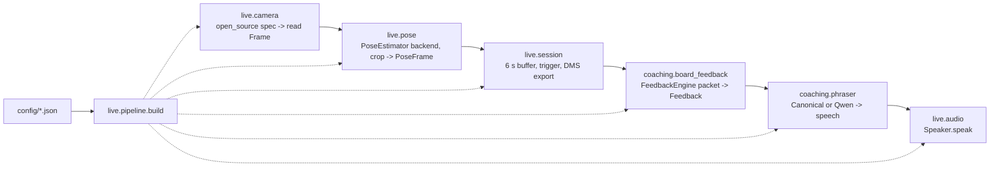

# Porting Djoker to Arduino VENTUNO Q

Status as of 17 Oct 2026 for the original pipeline. "Verified" means run and checked on the development host (macOS arm64); nothing here has run on the VENTUNO Q yet. The opt-in live audio integration below is hardware-unverified.

## Readiness

| Area | State | Evidence / gap |
|---|---|---|
| Packaging | Ready | `pip`-installable `djoker` (Python ≥ 3.10; runtime deps: numpy, opencv-python-headless, onnxruntime). Bundles install and pass `djoker-check` on Python 3.10, 3.13 and 3.14. Offline aarch64 bundle includes all wheels. |
| Pose (RTMPose-m ONNX, CPU) | Ready on host | 9 ms/frame on the dev host. Golden skeleton matches to 0.0 px across Python/onnxruntime versions. **Board CPU speed unknown**; QNN not attempted. |
| Team QCRTMPose package | Seam ready | Implement `estimate(image_bgr, box) -> (kp17, scores)` + `info`, register in `live.pose.make_pose_backend`. Must output COCO-17 order in original pixels, or adapt. |
| Camera | Partly | Saved video verified. Webcam path verified only with simulated cameras. **Android UVC on the board untested.** |
| Serve segmentation | By design | One serve per trigger (webcam) or per clip (saved video). Clips longer than the 4 s window log `clip_longer_than_window`. No automatic detection. |
| Completion trigger | Stand-in | Enter key → `Session.trigger(ms)`. **Physical button not wired.** |
| Analysis, comparison, rules | Ready (draft content) | Deterministic and golden-checked. Rules are `draft_unreviewed`. The reference is unvalidated, so strict mode gives an observation only; `allow_unvalidated_reference` enables Djokovic cues for demos. |
| Speech | Partly | Board default is `piper` (offline neural TTS; voice and aarch64 wheel bundled; 58 ms per sentence on the dev host). Falls back to `espeak-ng`, then text. **Board synthesis speed and speaker untested.** Playback needs `aplay` (alsa-utils). |
| Qwen | Client ready | Request, validator and 1 s timeout fallback are tested. **No Qwen model tested yet; on-board model and size undecided.** |
| Release evidence | Ready | `djoker-check` writes a JSON report: platform, providers, model hash, golden pose error and latency, decisions, camera FPS, audio, Qwen latency. |
| Golden fixtures | Private | They contain a real player, so they are not in git. Create them with `scripts/make_golden.py` into `local/golden/` (git-ignored); the bundle builder copies them into `golden/`. Without them, the golden checks report WARN (skipped). |

Open PRD items not addressed here:
- DMS contract drift between the PRD and `dms/` (seconds vs ms, angle order, `valid` array, file layout).
- The 0.8 confidence threshold (this backend scores ~0.74 at the event).
- No mute/stop control.
- Stage timings cover analysis, phrasing and audio start, but not capture or preprocessing.
- No 5-minute soak run.
- The bundle is built from uncommitted code (`BUILD_INFO.json` → `git_dirty: true`). Commit before the code freeze.

## Module map (each part is replaceable)



| Module | Interface |
|---|---|
| `live.camera` | `open_source('webcam:/dev/video0' or path)`; `.read() -> Frame(image, timestamp_ms, frame_id)` |
| `live.pose` | `make_pose_backend(cfg)`; `PoseEstimator(backend, crop).estimate(Frame) -> PoseFrame` |
| `pose2d.rtmpose` | `RTMPose(model_dir).estimate(image, box)`; `fetch_model(name, cache)` verifies SHA-256 |
| `dms` | `export_canonical(...)`, `load_packet(path)`, `validate_packet(meta, arrays)` |
| `compare2d.serve2d` | `detect_events`, `serve_metrics`, `estimate_yaw`: shared by the live path and the reference |
| `coaching.board_feedback` | `FeedbackEngine(table, rules, serve_type, allow)(packet) -> Feedback`; `validate(feedback, reply)` |
| `coaching.phraser` | `make_phraser(cfg).phrase(Feedback) -> {speech, source, latency_ms}` |
| `live.audio` | `Speaker(backend, wav_dir, voice).speak(text, code) -> AudioResult` (never raises); `fetch_voice(name, cache)` verifies SHA-256 |
| `live.session` | `Session(label, estimator, engine, phraser, speaker, out_dir)`: `.add(PoseFrame)`, `.trigger(ms)`, `.camera_fault()` |
| `live.pipeline` / `live.runner` / `live.check` | `build(load_config(path))`; `djoker-run`; `djoker-check` |

## Build and install

On the dev host:

```sh
.venv/bin/python scripts/build_bundle.py --target-python 3.12   # match the board's python3 --version (3.10-3.13)
```

This writes `dist/djoker-board-0.1.0-py3.12-manylinux_2_28_aarch64.tar.gz` (~220 MB, fully offline; Piper adds ~34 MB of wheel and a 63 MB voice). onnxruntime 1.31 wheels need glibc ≥ 2.28 (`ldd --version`). On Python 3.10, pip selects onnxruntime 1.23.2 (glibc ≥ 2.27).

On the board:

```sh
tar xzf djoker-board-*.tar.gz && cd djoker-board-*/
sha256sum -c MANIFEST.sha256 --quiet
sudo apt install alsa-utils       # aplay for Piper speech; optional fallback: espeak-ng
./install.sh
./check.sh --camera webcam:/dev/video0 --speak    # keep runs/board_check_*.json as release evidence
./run.sh                                          # live; ./run.sh --source clip.mov for replay
```

Share bundles that include `golden/` privately. Expected first-run result: `golden_pose` max error within 6 px and `golden_decisions` PASS. Record the reported latency: below ~66 ms/frame for 15 fps, below 100 ms for 10 fps. If it is slower, set a fixed `pose.crop`, lower the capture resolution, or try `"providers": ["QNNExecutionProvider", "CPUExecutionProvider"]` and confirm with `providers_active`.

## Opt-in live headphones and conversation

This extends the existing Piper backend and **the same active webcam worker**,
not a second camera demo. It does not change saved-video comparison, reference
abstention, canonical feedback or the existing Gemma review runner.

Live observations currently cover sustained whole-body visibility/framing and
static preparation only, from the first 17 RTMPose joints. They are **not
coach-validated technique thresholds**. There is no live ball-contact, stance
fault, arm fault, injury or pro-superiority inference. Motion/overhead activity
suppresses cues; stale frames and reference/session changes invalidate queued
work. Preparation does not imply that a serve is safe or technically correct.
Optional short Djokovic banter decorates the approved sentence, never the evidence.

### Runtime and deployment matrix

| Stage | Implemented path | Not claimed / remaining requirement |
|---|---|---|
| Pose | Existing RTMPose ONNX CPU webcam tracking and saved-video pipeline | No new accelerator model or benchmark |
| Dialogue | Existing OpenAI-compatible Qwen endpoint configuration; live replies select an approved sentence ID, then use canonical validation/fallback | A verified local Qwen/Gemma service must supply its own tokenizer, prompt template and runtime. The existing saved-video Gemma adapter remains separate; no guessed decoder flags or startup compilation |
| TTS | Existing persistent `PiperVoice`, ONNX/native; local `.onnx` + matching `.onnx.json` | Piper is **not ExecuTorch**. Compatible ExecuTorch TTS artifacts/runner remain unavailable |
| ASR | Optional `faster-whisper` / CTranslate2 English fallback, persistent model, float32 mono 16 kHz input, actual Whisper preprocessing/tokenizer/decoder in that library | Not ExecuTorch or NPU ASR. QCS8275 ExecuTorch Whisper needs a verified model/runner/tokenizer/preprocessing bundle plus expected transcript before an adapter can be added |
| Playback | Selected BlueZ MAC → stable sink/node identity; explicit targeted playback, no selected-device failure fallback to host speech | Sink presence is readiness evidence, **not a measured successful audible playback** |
| Microphone | Browser PTT, mono PCM16 WAV, 16 kHz, at most 10 seconds, in-memory Unix-socket upload and ASR | Half-duplex; no verified echo cancellation, hands-free VAD or barge-in. Browser microphone requires localhost or HTTPS |

The Python worker must run in the **audio user's session on the machine whose
Bluetooth adapter owns the selected headphones**. A Mac/host webcam worker cannot
route sound to the board's Bluetooth merely because it uses `adb` for camera
frames. For onboard Bluetooth, host the web/Python worker on VENTUNO Q and use
the local-camera option below. Saved-video board inference retains its existing
ADB requirements; local-camera mode does not turn that runner into a board-local
runner. The old host/ADB setup remains the default.

### Inspect, select, test (no automatic system changes)

Run under the intended audio user, not root. Inspect before installing or
replacing anything:

```sh
command -v bluetoothctl wpctl pactl pw-play paplay pw-record
systemctl status bluetooth --no-pager
systemctl --user status pipewire wireplumber pulseaudio --no-pager
bluetoothctl show
wpctl status
pactl info
pactl --format=json list sinks
pactl --format=json list sources
```

Missing utilities/services are diagnostics, not permission to replace the board's
audio stack. PipeWire's Pulse compatibility service supplies `pactl` discovery.
Selected-headphone playback currently requires native `pw-play` and a stable
`node.name`. PulseAudio-only systems are diagnosed but fail closed: `paplay`
cannot prevent stream-rescue routing to default speakers on disconnect.
Ensure the selected audio user has its normal D-Bus and `XDG_RUNTIME_DIR`
session; do not start a second root audio server over SSH. For a deliberately
headless deployment, an administrator may explicitly enable that user's linger
(`sudo loginctl enable-linger "$USER"`), then verify the user services and
WirePlumber Bluetooth seat/session policy for the installed image. Roll this
back with `sudo loginctl disable-linger "$USER"` if it was enabled for this app.
Do not blindly copy configuration from a different WirePlumber major version.

Choose **your** device address and put the headset in pairing mode. Each mutation
is a separate explicit command; no arbitrary discovery/auto-pairing occurs:

```sh
export HEADPHONES='AA:BB:CC:DD:EE:FF'  # replace with the selected device
python -m live.audio_check doctor --address "$HEADPHONES"
python -m live.audio_check pair --address "$HEADPHONES"
python -m live.audio_check trust --address "$HEADPHONES"
python -m live.audio_check connect --address "$HEADPHONES"
python -m live.audio_check doctor --address "$HEADPHONES"
python -m live.audio_check play --address "$HEADPHONES" --wav /absolute/path/to/known.wav
```

Paired, connected and audio-ready are separate states. Confirm the WAV is heard
only in the selected headphones; disconnect during playback and confirm silence
on host speakers. Audio errors remain visible and do not disable the camera.
Test A2DP playback separately from HFP/HSP microphone availability: inspect sources,
select the intended input in browser/system settings, and verify an English
sentence. Switching to a headset microphone may change the Bluetooth profile
and playback quality. A **USB microphone + Bluetooth headphones** is the
recommended fallback. The app does not change profiles or default devices.

### Install assets and start the existing UI

From the repository root, explicitly install only the extras needed:

```sh
python -m pip install -e '.[tts,asr]'       # optional [led] for RouterBridge
python -c 'from live.audio import fetch_voice; print(fetch_voice(cache="models/piper"))'
python -m live.audio_check synthesize \
  --voice models/piper/en_US-joe-medium.onnx \
  --text 'lets rock and roll' --output /tmp/djoker-known.wav
python -m live.audio_check play --address "$HEADPHONES" --wav /tmp/djoker-known.wav
python -m live.audio_check greeting --address "$HEADPHONES" \
  --voice models/piper/en_US-joe-medium.onnx --duration 10
python -m live.asr /absolute/path/to/known-english-16k-mono-pcm16.wav \
  --model /absolute/path/to/faster-whisper-tiny.en
```

Compare the ASR transcript to the known spoken sentence, not just an exit code.
Obtain a complete compatible faster-whisper/CTranslate2 model directory
(`model.bin`, configuration and tokenizer/preprocessor files) independently;
record upstream revision, license and SHA-256 of every supplied asset. Keep it
outside Git. The example config expects `models/faster-whisper-tiny.en`.
Piper's pinned Joe ONNX hash remains enforced by `fetch_voice`; also retain its
matching JSON/model card and verify external assets at provisioning time.
Piper code is GPL-3.0-or-later; the configured Joe voice data is CC0.
Whisper/CTranslate2/faster-whisper and any Qwen/Gemma bundle have separate licenses:
review the actual bundle's terms before redistribution. Do not include weights,
credentials or microphone audio in source control.

Copy `config/live-audio.json` to a private local path, set `audio.bluetooth_address`
to the selected MAC, and set **absolute** voice/model paths when moving the
configuration. Relative asset paths resolve against its directory.
`phraser.backend="qwen"` opts into the configured OpenAI-compatible endpoint;
otherwise deterministic dialogue works without an LLM. Set
`conversation.persona=true` for short banter, or leave it off.

```sh
export DJOKER_AUDIO_CONFIG=/absolute/path/to/private-live-audio.json
export DJOKER_PYTHON="$(command -v python)"
# Board-hosted webcam/audio only; omit these for the unchanged host/ADB camera:
export DJOKER_CAMERA_SOURCE=local
export DJOKER_CAMERA_DEVICE=/dev/video0  # inspect /dev/v4l/by-id; choose your camera
export DJOKER_ONNX=/absolute/path/to/existing-wholebody-rtmpose.onnx
cd web
npm ci
npm run dev -- --hostname 127.0.0.1
```

Use the existing live camera panel. Enable voice, wait for a debounced
audio-ready transition and the exact cached greeting **"lets rock and roll"**.
The pink/red browser heart is a routing indicator, not proof of sound. Hold PTT
to speak, then release to transcribe; browser recording stops after eight seconds
(the backend accepts at most ten seconds).
Input is gated during TTS; mute/cancel remain independent. Browser streams/tracks
are released after each utterance. WAV bytes cross a bounded local Unix socket,
not a recording file; transcripts/status are local ephemeral UI state. Do not
expose this unauthenticated local application to an untrusted network.
Cancellation invalidates queued/in-flight results and terminates playback
subprocesses. It does not forcibly interrupt a native Piper/CTranslate2 inference
already running; that worker discards its result when it returns.

### Optional physical indication — manual deployment only

Official sources inspected:
[matrix API](https://github.com/arduino/docs-content/blob/main/content/hardware/ventuno/boards/ventuno-q/tutorials/guides/led-matrix/led-matrix.md),
[RouterBridge API](https://github.com/arduino/docs-content/blob/main/content/hardware/ventuno/boards/ventuno-q/tutorials/guides/bridge/bridge.md),
[datasheet](https://github.com/arduino/docs-content/blob/main/content/hardware/ventuno/boards/ventuno-q/datasheet/en-datasheet.md).
The onboard matrix is **8×13 blue monochrome**, not RGB. Pink/red is therefore
browser-only. The optional `demo/ventuno-audio/ventuno-audio.ino` draws a blue heart
and uses the documented built-in status LED. Its short `provide_safe` callback
runs in the MCU loop, with no blocking inference or nested RPC.

Only if you explicitly choose to replace/merge your existing MCU sketch, install
the optional Python `[led]` extra, manually deploy that sketch via Arduino App
Lab/IDE, and set `led.backend="router"`. This application never flashes firmware,
changes router services, or opens reserved `/dev/ttyACM0`, `/dev/ttySTM0` or
`SerialUSB`. Wait for board boot to complete before testing. Missing Router,
package or sketch gives an actionable error and retains the browser heart.
There is no assumed external matrix or undocumented RGB pin mapping.

### Verification, performance and rollback

Hardware-independent checks:

```sh
python -m unittest tests.test_audio_devices tests.test_conversation tests.test_audio_bridge -v
python -m unittest discover -s tests
cd web && DJOKER_PYTHON="$(command -v python)" npm test && npx tsc --noEmit && npm run build
```

The live status reports bounded rolling p50/p95 monotonic stage timings.
`playback_request_ms` is a **request-time proxy**, not audible-start measurement;
neither process start nor successful WAV synthesis proves audible onset.
Measure actual output with an independently recorded loopback/acoustic signal
on the board. Capture timestamps are host receive timestamps after camera
transport, not sensor exposure times. Record frame/context age,
cue-to-playback-request, speech-end→ASR→dialogue→speech request and turn completion.
The implemented voice-turn origin is **server receipt of the PTT upload**, not
the microphone's physical speech end (`turn_complete_from_upload_ms`). Include
browser capture/upload delay separately when measuring end-to-end speech turns.
No latency budget or real-time performance guarantee has been established.

Still pending on hardware: onboard BlueZ pairing/reconnect/profile changes,
duplicate-event greeting under real radio loss, no-speaker leakage, A2DP versus
HFP/USB input, real known-WAV ASR transcript, Piper pronunciation, MCU sketch
compilation/heart, audio-user headless permissions, NPU model compatibility,
and sustained camera/voice load with p50/p95 plus independent audible-onset
measurement. Missing verified ExecuTorch ASR/TTS bundles are deployment blockers
for an **all-ExecuTorch** requirement, not implemented placeholder backends.

Rollback: mute/cancel, stop the camera, stop the web server, unset
`DJOKER_AUDIO_CONFIG`, `DJOKER_CAMERA_SOURCE`, `DJOKER_CAMERA_DEVICE`, and restart
with the previous environment. Remove `/tmp/djoker-known.wav`; retain or delete
external models according to your policy. To undo device setup explicitly use
`bluetoothctl disconnect "$HEADPHONES"` and, only if desired,
`bluetoothctl untrust "$HEADPHONES"` / `bluetoothctl remove "$HEADPHONES"`.
Restore your previous MCU sketch manually if replaced. No system audio server,
QNN version, firmware or root service was automatically installed or changed.
