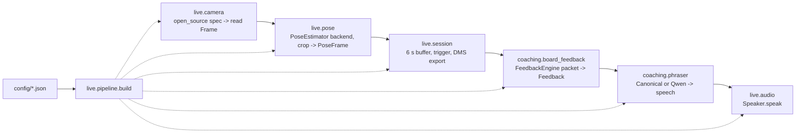

# Porting Djoker to Arduino VENTUNO Q

Status as of 17 Oct 2026. "Verified" means run and checked on the development host (macOS arm64); nothing here has run on the VENTUNO Q yet.

## Readiness

| Area | State | Evidence / gap |
|---|---|---|
| Packaging | Ready | `pip`-installable `djoker` (Python ≥ 3.10; runtime deps: numpy, opencv-python-headless, onnxruntime). Bundles install and pass `djoker-check` on Python 3.10, 3.13 and 3.14. Offline aarch64 bundle includes all wheels. |
| Pose (RTMPose-m ONNX, CPU) | Ready on host | 9 ms/frame on the dev host. Golden skeleton matches to 0.0 px across Python/onnxruntime versions. **Board CPU speed unknown**; QNN not attempted. |
| Team QCRTMPose package | Seam ready | Implement `estimate(image_bgr, box) -> (kp17, scores)` + `info`, register in `live.pose.make_pose_backend`. Must output COCO-17 order in original pixels, or adapt. |
| Camera | Partly | Saved video verified. Webcam path verified only with simulated cameras. **Android UVC on the board untested.** |
| Serve segmentation | By design | One serve per trigger (webcam) or per clip (saved video). Clips longer than the 4 s window log `clip_longer_than_window`. No automatic detection. |
| Completion trigger | Stand-in | Enter key → `Session.trigger(ms)`. **Physical button not wired.** |
| Analysis, comparison, rules | Ready (draft content) | Deterministic and golden-checked. Rules are `draft_unreviewed`. The reference is unvalidated, so strict mode gives an observation only; `allow_unvalidated_reference` enables Djokovic cues for demos. |
| Speech | Partly | Board default is `piper` (offline neural TTS; voice and aarch64 wheel bundled; 58 ms per sentence on the dev host). Falls back to `espeak-ng`, then text. **Board synthesis speed and speaker untested.** Playback needs `aplay` (alsa-utils). |
| Qwen | Client ready | Request, validator and 1 s timeout fallback are tested. **No Qwen model tested yet; on-board model and size undecided.** |
| Release evidence | Ready | `djoker-check` writes a JSON report: platform, providers, model hash, golden pose error and latency, decisions, camera FPS, audio, Qwen latency. |
| Golden fixtures | Private | They contain a real player, so they are not in git. Create them with `scripts/make_golden.py` into `local/golden/` (git-ignored); the bundle builder copies them into `golden/`. Without them, the golden checks report WARN (skipped). |

Open PRD items not addressed here:
- DMS contract drift between the PRD and `dms/` (seconds vs ms, angle order, `valid` array, file layout).
- The 0.8 confidence threshold (this backend scores ~0.74 at the event).
- No mute/stop control.
- Stage timings cover analysis, phrasing and audio start, but not capture or preprocessing.
- No 5-minute soak run.
- The bundle is built from uncommitted code (`BUILD_INFO.json` → `git_dirty: true`). Commit before the code freeze.

## Module map (each part is replaceable)



| Module | Interface |
|---|---|
| `live.camera` | `open_source('webcam:/dev/video0' or path)`; `.read() -> Frame(image, timestamp_ms, frame_id)` |
| `live.pose` | `make_pose_backend(cfg)`; `PoseEstimator(backend, crop).estimate(Frame) -> PoseFrame` |
| `pose2d.rtmpose` | `RTMPose(model_dir).estimate(image, box)`; `fetch_model(name, cache)` verifies SHA-256 |
| `dms` | `export_canonical(...)`, `load_packet(path)`, `validate_packet(meta, arrays)` |
| `compare2d.serve2d` | `detect_events`, `serve_metrics`, `estimate_yaw`: shared by the live path and the reference |
| `coaching.board_feedback` | `FeedbackEngine(table, rules, serve_type, allow)(packet) -> Feedback`; `validate(feedback, reply)` |
| `coaching.phraser` | `make_phraser(cfg).phrase(Feedback) -> {speech, source, latency_ms}` |
| `live.audio` | `Speaker(backend, wav_dir, voice).speak(text, code) -> AudioResult` (never raises); `fetch_voice(name, cache)` verifies SHA-256 |
| `live.session` | `Session(label, estimator, engine, phraser, speaker, out_dir)`: `.add(PoseFrame)`, `.trigger(ms)`, `.camera_fault()` |
| `live.pipeline` / `live.runner` / `live.check` | `build(load_config(path))`; `djoker-run`; `djoker-check` |

## Build and install

On the dev host:

```sh
.venv/bin/python scripts/build_bundle.py --target-python 3.12   # match the board's python3 --version (3.10-3.13)
```

This writes `dist/djoker-board-0.1.0-py3.12-manylinux_2_28_aarch64.tar.gz` (~220 MB, fully offline; Piper adds ~34 MB of wheel and a 63 MB voice). onnxruntime 1.31 wheels need glibc ≥ 2.28 (`ldd --version`). On Python 3.10, pip selects onnxruntime 1.23.2 (glibc ≥ 2.27).

On the board:

```sh
tar xzf djoker-board-*.tar.gz && cd djoker-board-*/
sha256sum -c MANIFEST.sha256 --quiet
sudo apt install alsa-utils       # aplay for Piper speech; optional fallback: espeak-ng
./install.sh
./check.sh --camera webcam:/dev/video0 --speak    # keep runs/board_check_*.json as release evidence
./run.sh                                          # live; ./run.sh --source clip.mov for replay
```

Share bundles that include `golden/` privately. Expected first-run result: `golden_pose` max error within 6 px and `golden_decisions` PASS. Record the reported latency: below ~66 ms/frame for 15 fps, below 100 ms for 10 fps. If it is slower, set a fixed `pose.crop`, lower the capture resolution, or try `"providers": ["QNNExecutionProvider", "CPUExecutionProvider"]` and confirm with `providers_active`.
